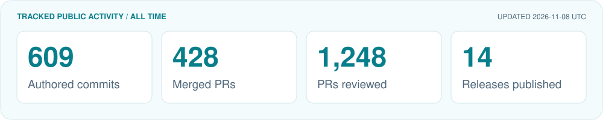

  

  <strong>Scientific Software Engineer · Open-Source Maintainer · Computational Physicist</strong> 
  Quantum Software Developer at <a href="https://www.xanadu.ai/">Xanadu</a> · Ph.D. in Physics &amp; Astronomy, <a href="https://uwaterloo.ca/">University of Waterloo</a> 
  Research background at <a href="https://perimeterinstitute.ca/">Perimeter Institute</a>

I build reliable scientific software: numerical simulation, quantum-programming APIs, compiler-facing integration, and the testing and release infrastructure behind them. My current work includes core contributions to the [PennyLane](https://github.com/PennyLaneAI/pennylane) open-source ecosystem.

## Selected engineering work

- **Numerical correctness and simulation:** contributions to density-matrix execution, including a [`default.mixed` bug fix](https://github.com/PennyLaneAI/pennylane/pull/8593) and a [local `QubitDensityMatrix` application fix](https://github.com/PennyLaneAI/pennylane/pull/8933).
- **Quantum APIs and program capture:** [migrated `IQPEmbedding` to `Operator2`](https://github.com/PennyLaneAI/pennylane/pull/10221) and addressed [captured control values in PennyLane](https://github.com/PennyLaneAI/pennylane/pull/10356) and [Catalyst](https://github.com/PennyLaneAI/catalyst/pull/3373).
- **CI and test reliability:** work on [CI thread/process overhead](https://github.com/PennyLaneAI/pennylane/pull/10404), a [flaky numerical eigensolver test](https://github.com/PennyLaneAI/pennylane/pull/10366), and [test-splitting strategy](https://github.com/PennyLaneAI/pennylane/pull/9519).

These are **authored, merged public PRs**, not claims of sole ownership of the underlying projects. [More examples and source links](./docs/engineering.md).

## Beyond PennyLane

My physics research focuses on strongly correlated quantum systems and tensor-network methods; see [KitaevLadder](https://github.com/JerryChen97/KitaevLadder) for an early public research-code example. I also work on numerical optimization and verifiable scientific/AI-agent evaluation workflows. Not all of that work is public.

**Tools I work with:** Python, JAX, NumPy/SciPy, pytest, GitHub Actions, quantum simulation, and scientific computing.

## Public GitHub activity

The dashboard below summarizes **public GitHub records** across PennyLaneAI, XanaduAI, and my own repositories. It distinguishes authored commits, authored-and-merged PRs, PRs reviewed, and releases published; the counts are **not additive**. See the [scope and methodology](./docs/pulse.md).

<!-- PULSE:START -->
<picture>
  <source media="(prefers-color-scheme: dark)" srcset="./assets/pulse-dark.svg" />
  
</picture>
<!-- PULSE:END -->

  <a href="https://www.linkedin.com/in/yushao-chen/">LinkedIn</a> ·
  <a href="mailto:chenys13@outlook.com">Email</a> ·
  Open to scientific software and engineering collaboration 
  Pronouns: They/Them, He/Him

Teaching and consulting

I also have experience tutoring college-level mathematics, physics, and computer science and advising on graduate applications.

